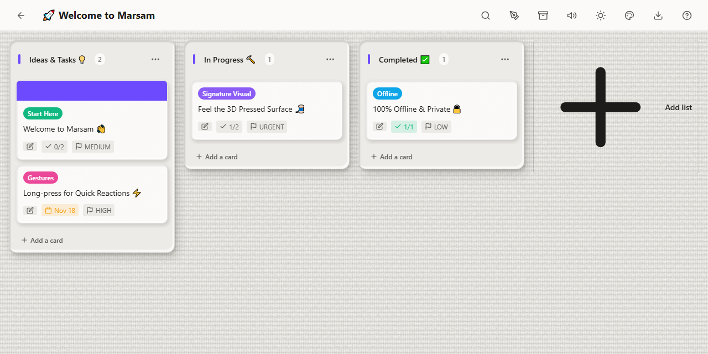
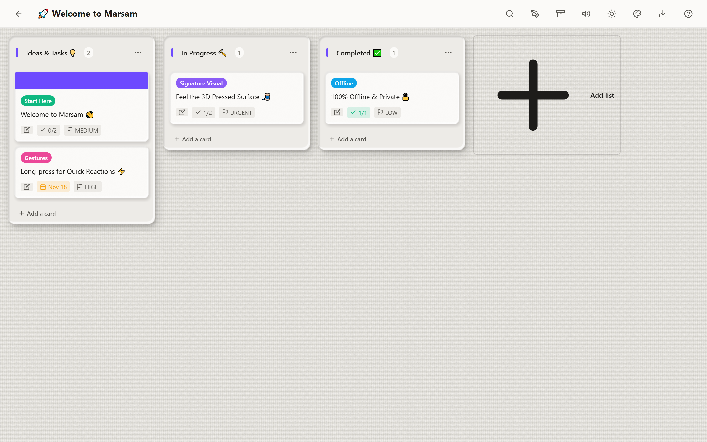
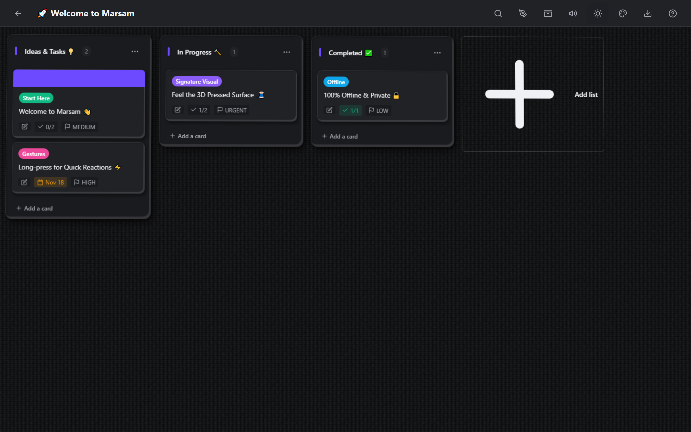
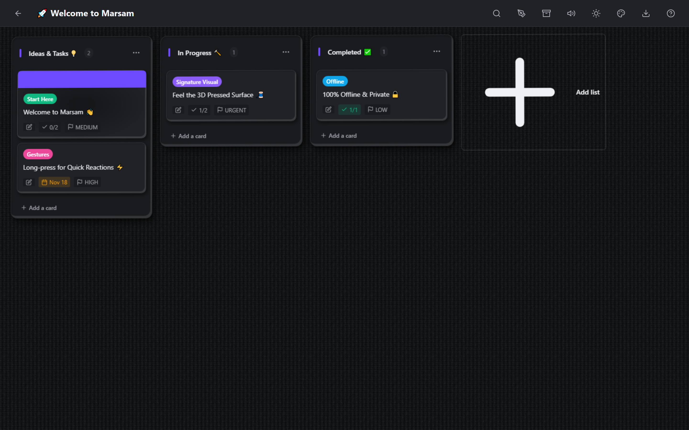
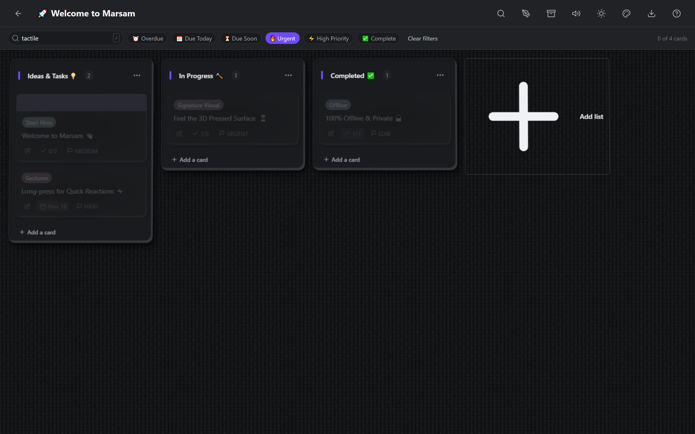
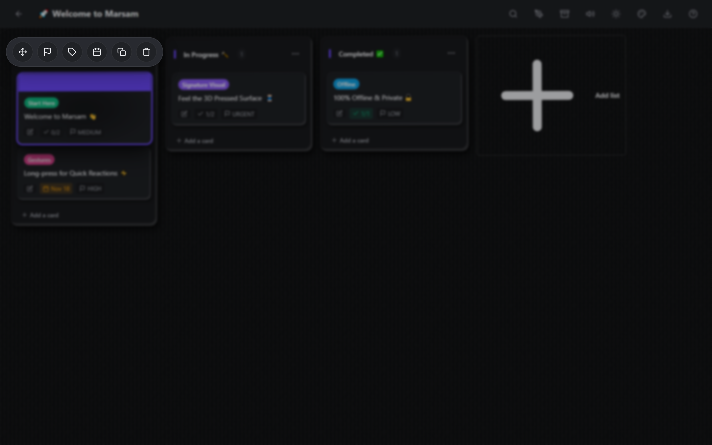
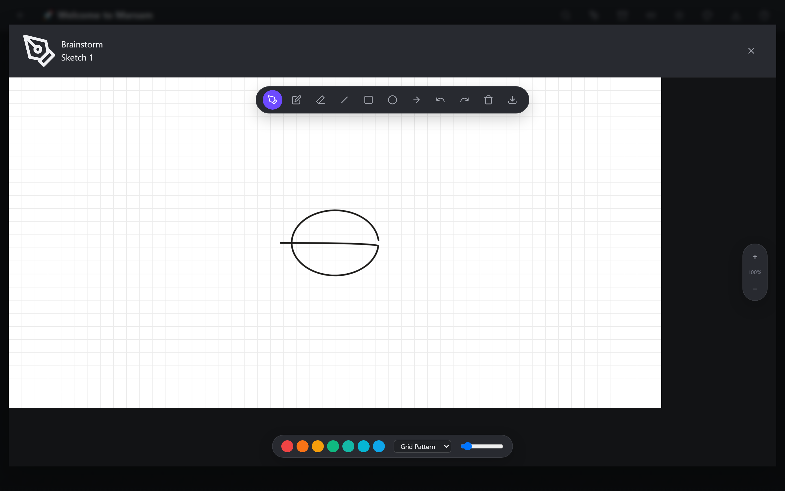
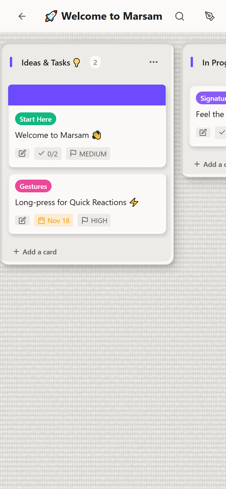
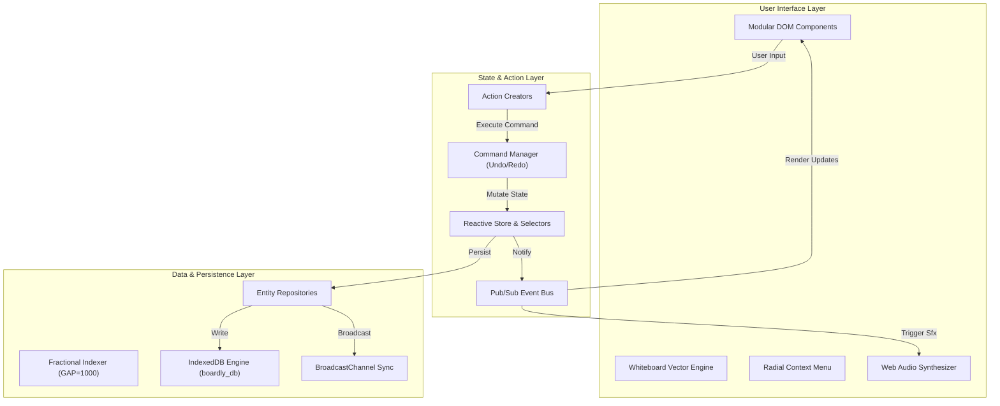
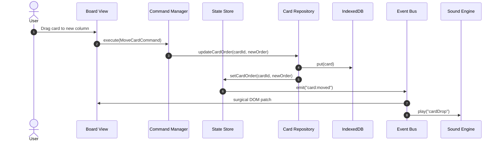

<p align="center">
  
</p>

<h1 align="center">Marsam (مرسم)</h1>

<p align="center">
  <strong>A tactile, offline-first project management system pressed into 3D woven cloth.</strong>
</p>

<p align="center">
  <a href="https://github.com/MohamedAliShaltoot/Marsam/actions/workflows/test.yml"></a>
  <a href="https://github.com/MohamedAliShaltoot/Marsam/actions/workflows/deploy.yml"></a>
  
  
  
  
  
</p>

<p align="center">
  <a href="https://mohamedalishaltoot.github.io/Marsam/"><strong>🌐 Launch Live Demo</strong></a> •
  <a href="README.ar.md"><strong>🇸🇦 العربية (Arabic)</strong></a> •
  <a href="docs/ARCHITECTURE.md"><strong>📐 Architecture Specification</strong></a>
</p>

<p align="center">
  
</p>

---

## 🎨 Visual Showcase

### Board Themes (Light & Dark)
<table>
  <tr>
    <td width="50%"><strong>☀️ Light Canvas</strong></td>
    <td width="50%"><strong>🌙 Dark Canvas</strong></td>
  </tr>
  <tr>
    <td></td>
    <td></td>
  </tr>
</table>

### Fluid Workflows & Tools
<table>
  <tr>
    <td width="33%"><strong>📝 Rich Card Modal</strong></td>
    <td width="33%"><strong>🔍 Live Search & Filter</strong></td>
    <td width="33%"><strong>⚡ Radial Context Menu</strong></td>
  </tr>
  <tr>
    <td></td>
    <td></td>
    <td></td>
  </tr>
  <tr>
    <td width="33%"><strong>🎨 Vector Whiteboard</strong></td>
    <td width="33%"><strong>📱 Responsive Mobile View</strong></td>
    <td width="33%"><strong>🏠 Projects Dashboard</strong></td>
  </tr>
  <tr>
    <td></td>
    <td></td>
    <td></td>
  </tr>
</table>

---

## ✨ Features at a Glance

- **3D Woven Cloth Depth**: Real depth falloff, dynamic mouse tilt parallax, and pressed-in surface styling using pure CSS tokens and SVG filters.
- **Zero Runtime Dependencies**: No React, no Vue, no Tailwind, no CDNs. Pure vanilla HTML5, CSS3, and native ES Modules.
- **100% Offline-First**: All projects, boards, cards, and drawings persist locally in your browser's IndexedDB. Your data never leaves your device.
- **Pointer Drag & Drop with FLIP**: Smooth pointer-based card and column reordering powered by fractional indexing and First-Last-Invert-Play animations.
- **Synthesized Web Audio Engine**: Zero audio file downloads. Every click, card lift, soft thud, and checklist arpeggio is synthesized dynamically in real time via Web Audio API.
- **Long-Press Radial Menu**: WhatsApp-inspired contextual action wheel for instant card operations on mobile and desktop.
- **Built-in Vector Whiteboard**: Full drawing modal with pen, highlighter, shapes, arrows, color swatches, and background pattern generators.
- **Light, Dark & System Themes**: Multi-palette styling with customizable accent colors (Violet, Ocean, Emerald, Amber, Rose).
- **Cross-Platform Desktop App**: Native Windows installer (NSIS 64-bit) with custom scheme `app://boardly/` for permanent storage isolation.
- **Installable PWA**: Offline Service Worker shell caching with full Web App Manifest support.

---

## 🏗️ How It Works (Architecture)

Marsam enforces a strict unidirectional data flow and clean separation of concerns. Every source file adheres strictly to a 250-line maximum limit.

### System Architecture


### Unidirectional Data Flow


---

## ⚡ Technical Highlights

| Component | Technical Implementation |
| :--- | :--- |
| **Runtime Architecture** | Pure ES Modules, zero build step required for web execution. |
| **State Management** | Centralized reactive store with immutable snapshots and selector subscriptions. |
| **Undo / Redo** | Command pattern with an execution stack and inverse command handlers. |
| **Card Ordering** | Fractional indexing ($O(1)$ reordering, zero bulk database writes). |
| **CSS Architecture** | Custom property tokens, BEM methodology, CSS logical properties (`margin-inline`, `padding-block`). |
| **Accessibility** | Semantic HTML5, full keyboard shortcuts, ARIA live regions, `prefers-reduced-motion` and `prefers-reduced-sound`. |
| **Sound Synthesis** | Real-time Web Audio graph (OscillatorNode, GainNode, DynamicsCompressorNode). |
| **Desktop Wrapper** | Electron 33 with sandboxed privileges, `contextIsolation: true`, single-instance lock. |

---

## 📂 Repository Structure

```
Marsam/
├── assets/                  # SVG icon sprite, favicon, web manifest
├── css/                     # Design tokens, themes, layouts, animations, components
├── js/
│   ├── core/                # Event bus, store, command manager, router, DOM utils
│   ├── data/                # IndexedDB wrapper, repositories, fractional indexing
│   ├── features/            # Home, board, dnd, search, whiteboard, radial menu, sound
│   ├── ui/                  # Accessible modals, toasts, dropdowns, icons
│   └── utils/               # Relative timestamps, string dictionaries
├── desktop/                 # Electron wrapper, NSIS build config, custom protocol
├── docs/                    # Architecture notes and high-resolution media
├── tests/                   # Automated unit tests running on Node test runner
├── tools/                   # Dev tooling (AST comment stripper, media capture)
├── index.html               # Web application entry point
├── server.js                # Zero-dependency local development server
└── sw.js                    # Offline PWA service worker
```

---

## 🚀 Getting Started

### Prerequisites
- Modern web browser (Chrome, Edge, Firefox, Safari).
- Node.js >= 20.x (only if running the local dev server, desktop wrapper, or tests).

### Run Locally (Zero Build Step)
1. Clone the repository:
   ```bash
   git clone https://github.com/MohamedAliShaltoot/Marsam.git
   cd Marsam
   ```
2. Start the built-in zero-dependency static server:
   ```bash
   node server.js
   ```
3. Open `http://localhost:3000` in your browser.

### Run Automated Tests
```bash
node --test tests/*.test.js
```

---

## 💻 Desktop Application (Windows)

Marsam includes a native 64-bit Windows desktop installer built with Electron:
- **Custom Protocol**: Serves the application via privileged `app://boardly/` for permanent storage isolation.
- **Safety Backups**: Automatic IndexedDB safety backups stored in `%APPDATA%\Boardly\backups` before version upgrades.
- **Single Instance**: Focuses existing window on duplicate launches.

### Build Desktop Installer
```bash
cd desktop
npm install
npm run dist
```
The installer will be generated in `desktop/dist/Boardly Setup 1.0.0.exe`.

---

## ⌨️ Keyboard Shortcuts

| Shortcut | Action |
| :--- | :--- |
| `/` | Open live search & filter bar |
| `W` | Open vector whiteboard |
| `T` | Toggle Light / Dark theme |
| `M` | Quick mute / unmute audio |
| `Ctrl / Cmd + Z` | Undo last card or list action |
| `Ctrl / Cmd + Y` | Redo action |
| `Escape` | Close active modal, search bar, or radial menu |
| `?` | Show keyboard shortcuts guide |

---

## 🔒 Privacy & Data Sovereignty

Marsam does not collect telemetry, track usage, or connect to external servers. All project management data, drawings, and custom settings remain 100% on your local machine within IndexedDB.

---

## 👤 Author

**Mohamed Ali Shaltout**
- GitHub: [@MohamedAliShaltoot](https://github.com/MohamedAliShaltoot)

---

## 📄 License

This project is licensed under the [MIT License](LICENSE).
